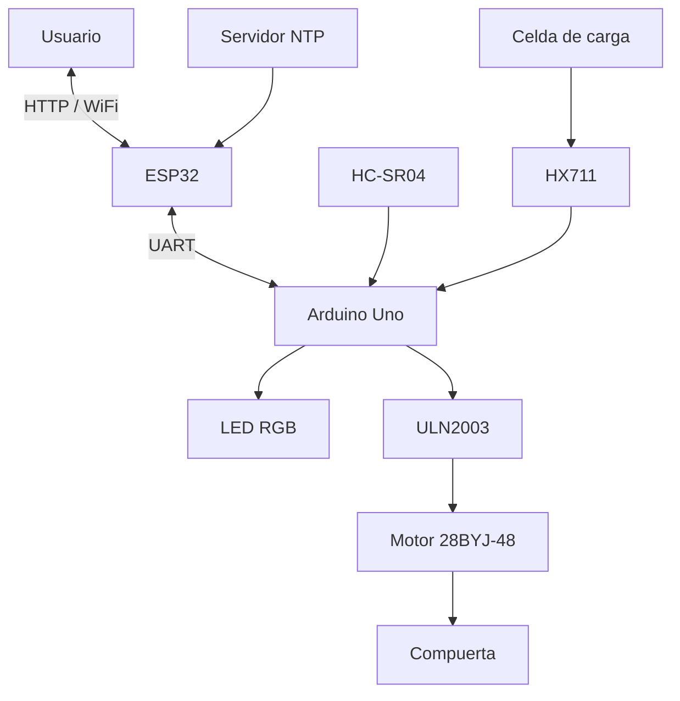
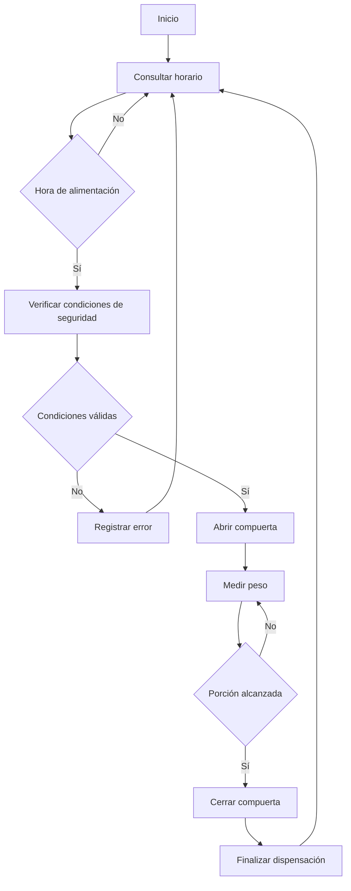

El codigo se realizó con apoyo de la IA, pero supervisado por humanos

- Programación de hasta 4 porciones diarias.
- Configuración de horarios y cantidades en gramos.
- Dispensación manual y automática.
- Interfaz web alojada en el ESP32.
- Sincronización de hora mediante NTP.
- Comunicación UART entre microcontroladores.
- Almacenamiento de configuraciones en memoria no volátil.
- Monitoreo del nivel de alimento.
- Calibración y tara de la báscula.
- Configuración de apertura, cierre y velocidad del motor.
- Control del Arduino mediante registros e interrupciones.
- Manejo de errores y condiciones de seguridad.

## Componentes

| Componente | Función |
|---|---|
| Arduino Uno ATmega328P | Control de sensores y actuadores |
| ESP32 | Servidor web y programación de horarios |
| HC-SR04 | Medición del nivel de alimento |
| Celda de carga de 10 kg | Medición del peso |
| HX711 | Adquisición de datos de la celda de carga |
| 28BYJ-48 | Movimiento de la compuerta |
| ULN2003 | Controlador del motor paso a paso |
| LED RGB de ánodo común | Indicador del nivel de alimento |
| Fuente de 5 V / 3 A | Alimentación del sistema |

## Arquitectura del sistema



## Firmware del Arduino Uno

El Arduino Uno se encarga del control de bajo nivel
del sistema mediante el ATmega328P.

### Funciones principales

- Adquisición del peso mediante el HX711.
- Medición de distancia mediante el HC-SR04.
- Control del LED RGB mediante registros.
- Control de las bobinas del motor paso a paso.
- Gestión de temporizadores e interrupciones.
- Recepción y procesamiento de comandos UART.
- Apertura y cierre de la compuerta.
- Detección de condiciones inseguras.
- Desenergización de las bobinas del motor cuando
  no se encuentra en movimiento.

### Registros utilizados

El firmware utiliza registros del ATmega328P para
controlar directamente sus periféricos.

| Registro | Función |
|---|---|
| DDRD | Configuración de entradas y salidas |
| PORTD | Control de salidas digitales |
| DDRB | Configuración del puerto B |
| PORTB | Control del puerto B |
| TCCR1A | Configuración del Timer1 |
| TCCR1B | Configuración del modo y prescaler |
| OCR1A | Registro de comparación |
| TIMSK1 | Habilitación de interrupciones del Timer1 |

## Firmware del ESP32

El ESP32 funciona como controlador de alto nivel
y proporciona una interfaz entre el usuario y el Arduino.

### Funciones principales

- Conexión a una red WiFi.
- Alojamiento del servidor web.
- Obtención de la hora mediante NTP.
- Administración de horarios de alimentación.
- Configuración de porciones.
- Dispensación manual.
- Configuración y prueba del motor.
- Visualización del peso y nivel de la tolva.
- Almacenamiento persistente de configuraciones.
- Comunicación con Arduino mediante UART.

### Librerías principales

| Librería | Función |
|---|---|
| WiFi.h | Conexión inalámbrica |
| WebServer.h | Servidor HTTP |
| Preferences.h | Almacenamiento no volátil |
| time.h | Administración de fecha y hora |

### Estructuras de datos

El programa utiliza estructuras para organizar
los parámetros de funcionamiento.

- `ConfigMotor`: configuración del motor.
- `Porcion`: horario y cantidad de alimento.
- `Plan`: planificación diaria de alimentación.

## Comunicación

| Tecnología | Aplicación |
|---|---|
| UART | Comunicación Arduino - ESP32 |
| WiFi | Conexión a la red local |
| HTTP | Comunicación con la interfaz web |
| NTP | Sincronización de la hora |

La comunicación UART opera a 9600 baudios.
Se utiliza adaptación de nivel lógico entre la
salida de 5 V del Arduino y la entrada de 3.3 V
del ESP32.

Todos los componentes deben compartir GND.

## Monitoreo de la tolva

El sensor ultrasónico mide la distancia entre
la parte superior de la tolva y el alimento.

| Distancia | Estado esperado | Color |
|---|---|---|
| Hasta 3 cm | Lleno | Verde |
| Mayor a 3 y hasta 8 cm | Medio | Naranja |
| Mayor a 8 y hasta 10 cm | Bajo | Rojo |

El LED RGB es de ánodo común, por lo que sus
salidas funcionan mediante lógica invertida.

### Conexiones del LED RGB

| Terminal | Arduino | Registro |
|---|---|---|
| Rojo | D4 | PD4 |
| Verde | D5 | PD5 |
| Azul | D6 | PD6 |
| Ánodo común | 3.3 V | - |

Cada canal debe contar con su resistencia
limitadora de corriente.

## Instalación

### Arduino Uno

1. Instalar Arduino IDE.
2. Abrir el firmware correspondiente al Arduino.
3. Seleccionar la placa Arduino Uno.
4. Seleccionar el puerto COM.
5. Compilar y cargar el programa.

### ESP32

1. Instalar el paquete de placas ESP32 de Espressif.
2. Abrir el firmware correspondiente al ESP32.
3. Configurar el SSID y contraseña de la red WiFi.
4. Seleccionar la placa ESP32 correspondiente.
5. Compilar y cargar el programa.
6. Abrir el monitor serial.
7. Obtener la dirección IP asignada al ESP32.
8. Introducir la dirección IP en un navegador.

## Calibración

### Celda de carga

1. Retirar cualquier peso de la plataforma.
2. Realizar la tara.
3. Colocar un objeto de peso conocido.
4. Introducir su peso en gramos.
5. Calcular el factor de calibración.
6. Verificar las mediciones.

### Motor

1. Establecer la posición cerrada de referencia.
2. Configurar los pasos de apertura.
3. Configurar los pasos de cierre.
4. Ajustar la velocidad y el sentido de giro.
5. Realizar una prueba de funcionamiento.

## Funcionamiento de la dispensación



## Manejo de errores

El sistema contempla condiciones como:

- Falta de referencia de la posición cerrada.
- Configuración incorrecta del motor.
- Dosis no segura.
- Errores de comunicación.
- Lecturas inválidas de los sensores.
- Fluctuaciones en las mediciones de peso.
- Pérdida de conexión WiFi.

## Seguridad

- Utilizar una fuente de alimentación adecuada.
- Mantener una conexión GND común.
- No conectar señales de 5 V directamente al ESP32.
- No alimentar el motor desde un pin digital.
- Verificar la calibración antes de dispensar.
- Supervisar las primeras pruebas de funcionamiento.

## Estructura del repositorio

```text
Dispensador-IoT/
├── Arduino/
│   └── Arduino.ino
├── ESP32/
│   └── ESP32.ino
└── README.md
```

## Tecnologías utilizadas


- C++
- HTML
- CSS
- JavaScript
- Arduino
- ESP32


